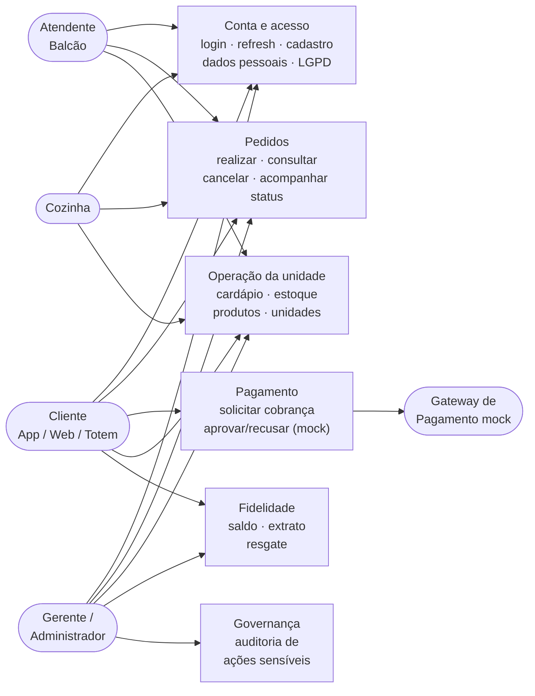

# Diagrama de Casos de Uso

Para manter legibilidade no PDF, os casos de uso estão agrupados por área de funcionalidade
(as ligações ator → área indicam quem pode executar o quê). A lista completa está na tabela
abaixo do diagrama.

## Casos de uso por área

| Área | Casos de uso | Atores |
|---|---|---|
| Conta e acesso | realizar login; renovar sessão; encerrar sessão; cadastrar-se; consultar dados pessoais; exportar dados (portabilidade); anonimizar conta | Cliente, Atendente, Cozinha, Gerente/Admin |
| Pedidos | realizar pedido; criar pedido no balcão; consultar pedido; acompanhar status; cancelar pedido | Cliente, Atendente, Cozinha, Gerente/Admin |
| Pagamento | solicitar pagamento; processar pagamento (mock); consultar pagamento | Cliente, Gateway mock |
| Operação da unidade | consultar cardápio; ajustar cardápio da unidade; consultar estoque; movimentar estoque; gerenciar produtos; cadastrar unidade | Cliente (consulta), Atendente, Cozinha, Gerente/Admin |
| Fidelidade | consultar saldo; consultar extrato; resgatar pontos no pedido | Cliente, Gerente/Admin |
| Governança | consultar log de auditoria | Gerente/Admin (ADMIN) |

## UC 01 — Realizar Pedido + Solicitar Pagamento (fluxo crítico)

**Descrição:** cliente monta o pedido em um canal (App, Totem, Balcão, Pick-up ou Web),
o servidor reserva o estoque da unidade e a solicitação de pagamento é enviada ao gateway
mock, que devolve aprovação ou recusa.

**Atores:** Cliente (principal), Gateway de Pagamento (secundário — simulado).

**Pré-condições**
1. Usuário autenticado com JWT válido.
2. Unidade ativa e produto disponível no cardápio da unidade.
3. Saldo de estoque suficiente para todos os itens.

**Pós-condições**
- Sucesso: pedido em `PAGO`, estoque baixado, pontos creditados (se houver consentimento).
- Recusa: pedido em `CANCELADO`, reserva liberada, sem crédito de pontos.

**Fluxo principal**
1. Cliente envia `POST /pedidos` com `canalPedido`, `unidadeId` e itens.
2. Sistema valida canal, unidade, cardápio, produto ativo e disponibilidade de estoque.
3. Sistema congela o preço do cardápio, calcula subtotal e aplica resgate de pontos, se solicitado.
4. Sistema reserva o estoque (`RESERVA`) e cria o pedido em `AGUARDANDO_PAGAMENTO`.
5. Cliente envia `POST /pagamentos` com `Idempotency-Key`.
6. Gateway mock devolve transação aprovada.
7. Sistema converte reserva em baixa, move o pedido para `PAGO` e credita pontos.
8. Cliente consulta `GET /pedidos/{id}` e acompanha o status.

**Fluxos de exceção**
| Cenário | Resposta |
|---|---|
| `canalPedido` ausente ou inválido | `422 DADOS_INVALIDOS` |
| Unidade/produto/estoque inexistente | `404 RECURSO_NAO_ENCONTRADO` |
| Produto indisponível na unidade | `409 PRODUTO_INDISPONIVEL` |
| Estoque insuficiente | `409 ESTOQUE_INSUFICIENTE` |
| Repetição de `Idempotency-Key` | `200` com o pagamento original (sem nova baixa) |
| Pagamento recusado | `201 RECUSADO` + pedido `CANCELADO` + reserva liberada |
| Pedido já processado | `409 PEDIDO_JA_PROCESSADO` |

**Regras de negócio**
- RN1: `canalPedido` é obrigatório e rastreável em todas as consultas.
- RN2: o total é sempre calculado no servidor.
- RN3: a reserva só vira baixa com pagamento aprovado.
- RN4: idempotência garante que retry não duplica cobrança nem pontos.
- RN5: resgate exige consentimento LGPD e múltiplos de 100 pontos.
