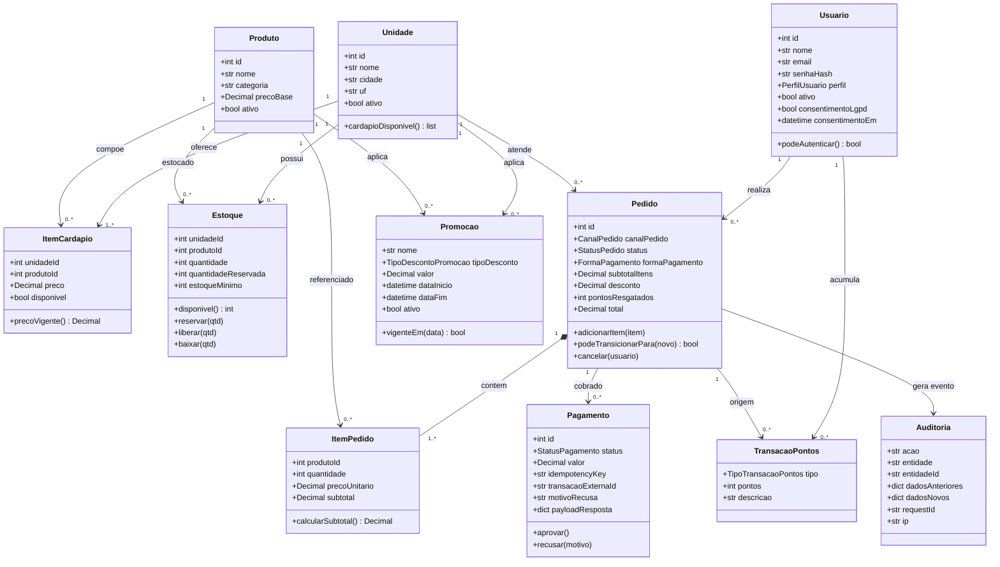
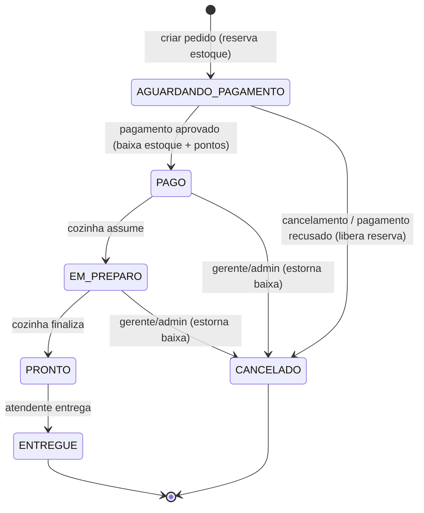

# Diagrama de Classes (visão de domínio)

## Máquina de estados do pedido

| Transição | Perfis autorizados |
|---|---|
| `AGUARDANDO_PAGAMENTO → PAGO` | sistema (pagamento), ADMIN, GERENTE, ATENDENTE |
| `AGUARDANDO_PAGAMENTO → CANCELADO` | CLIENTE (próprio), ATENDENTE, GERENTE, ADMIN |
| `PAGO → EM_PREPARO` | COZINHA, GERENTE, ADMIN |
| `PAGO → CANCELADO` | GERENTE, ADMIN |
| `EM_PREPARO → PRONTO` | COZINHA, GERENTE, ADMIN |
| `EM_PREPARO → CANCELADO` | GERENTE, ADMIN |
| `PRONTO → ENTREGUE` | ATENDENTE, GERENTE, ADMIN |
