# DER — Diagrama Entidade-Relacionamento

Modelo compatível com as migrations do Alembic (`migrations/versions/`).

```mermaid
erDiagram
    USUARIOS {
        int id PK
        string nome
        string email UK
        string senha_hash
        enum perfil "ADMIN|GERENTE|ATENDENTE|COZINHA|CLIENTE"
        string telefone
        bool ativo
        bool consentimento_lgpd
        datetime consentimento_em
        datetime criado_em
    }

    UNIDADES {
        int id PK
        string nome
        string cidade
        string uf
        string endereco
        bool ativo
    }

    PRODUTOS {
        int id PK
        string nome
        string categoria
        numeric preco_base
        bool ativo
    }

    CARDAPIO_UNIDADE {
        int id PK
        int unidade_id FK
        int produto_id FK
        numeric preco
        bool disponivel
    }

    ESTOQUES {
        int id PK
        int unidade_id FK
        int produto_id FK
        int quantidade
        int quantidade_reservada
        int estoque_minimo
    }

    MOVIMENTACOES_ESTOQUE {
        int id PK
        int unidade_id FK
        int produto_id FK
        int pedido_id FK
        int usuario_id FK
        enum tipo "ENTRADA|SAIDA|RESERVA|LIBERACAO|BAIXA"
        int quantidade
        string motivo
    }

    PEDIDOS {
        int id PK
        int cliente_id FK
        int unidade_id FK
        enum canal_pedido "APP|TOTEM|BALCAO|PICKUP|WEB"
        enum status "AGUARDANDO_PAGAMENTO|PAGO|EM_PREPARO|PRONTO|ENTREGUE|CANCELADO"
        enum forma_pagamento
        numeric subtotal_itens
        numeric desconto
        int pontos_resgatados
        numeric total
        string observacao
    }

    PEDIDO_ITENS {
        int id PK
        int pedido_id FK
        int produto_id FK
        int quantidade
        numeric preco_unitario
        numeric subtotal
    }

    PAGAMENTOS {
        int id PK
        int pedido_id FK
        enum status "PENDENTE|APROVADO|RECUSADO"
        numeric valor
        string idempotency_key UK
        string transacao_externa_id
        string motivo_recusa
        json payload_resposta
    }

    PEDIDO_STATUS_HISTORICO {
        int id PK
        int pedido_id FK
        int usuario_id FK
        enum status_anterior
        enum status_novo
        string observacao
    }

    PONTOS_TRANSACOES {
        int id PK
        int cliente_id FK
        int pedido_id FK
        enum tipo "CREDITO|DEBITO"
        int pontos
        string descricao
    }

    PROMOCOES {
        int id PK
        int unidade_id FK
        int produto_id FK
        string nome
        enum tipo_desconto "PERCENTUAL|VALOR_FIXO"
        numeric valor
        datetime data_inicio
        datetime data_fim
        bool ativo
    }

    AUDITORIA_LOGS {
        int id PK
        int usuario_id FK
        string acao
        string entidade
        string entidade_id
        json dados_anteriores
        json dados_novos
        string request_id
        string ip
        datetime criado_em
    }

    REFRESH_TOKENS {
        int id PK
        int usuario_id FK
        string token_hash UK
        datetime expira_em
        bool revogado
    }

    USUARIOS ||--o{ PEDIDOS : "realiza"
    USUARIOS ||--o{ PONTOS_TRANSACOES : "acumula"
    USUARIOS ||--o{ REFRESH_TOKENS : "autentica"
    USUARIOS ||--o{ AUDITORIA_LOGS : "gera"
    USUARIOS ||--o{ MOVIMENTACOES_ESTOQUE : "lanca"

    UNIDADES ||--o{ CARDAPIO_UNIDADE : "oferece"
    PRODUTOS ||--o{ CARDAPIO_UNIDADE : "compoe"

    UNIDADES ||--o{ ESTOQUES : "possui"
    PRODUTOS ||--o{ ESTOQUES : "estocado"

    UNIDADES ||--o{ PEDIDOS : "atende"
    PEDIDOS ||--|{ PEDIDO_ITENS : "contem"
    PRODUTOS ||--o{ PEDIDO_ITENS : "vendido"

    PEDIDOS ||--o{ PAGAMENTOS : "cobrado"
    PEDIDOS ||--o{ PEDIDO_STATUS_HISTORICO : "historico"
    PEDIDOS ||--o{ PONTOS_TRANSACOES : "origem"
    PEDIDOS ||--o{ MOVIMENTACOES_ESTOQUE : "movimenta"

    UNIDADES ||--o{ MOVIMENTACOES_ESTOQUE : "registra"
    PRODUTOS ||--o{ MOVIMENTACOES_ESTOQUE : "movimenta"

    UNIDADES ||--o{ PROMOCOES : "aplica"
    PRODUTOS ||--o{ PROMOCOES : "aplica"
```

## Restrições relevantes

| Restrição | Tabela | Motivo |
|---|---|---|
| `UNIQUE(email)` | usuarios | impedir cadastro duplicado |
| `UNIQUE(unidade_id, produto_id)` | cardapio_unidade, estoques | um item por unidade |
| `CHECK(quantidade_reservada <= quantidade)` | estoques | reserva nunca maior que o saldo físico |
| `CHECK(total >= 0)` | pedidos | total líquido não negativo |
| `UNIQUE(idempotency_key)` | pagamentos | retry de pagamento não duplica cobrança |
| `UNIQUE(pedido_id, tipo)` | pontos_transacoes | um crédito e um débito por pedido |
| `CHECK(quantidade > 0)` | pedido_itens, movimentacoes_estoque | quantidade sempre positiva |
| FK com `ON DELETE CASCADE` | pedido_itens, pagamentos, pedido_status_historico, refresh_tokens | filhos não sobrevivem ao pai |
