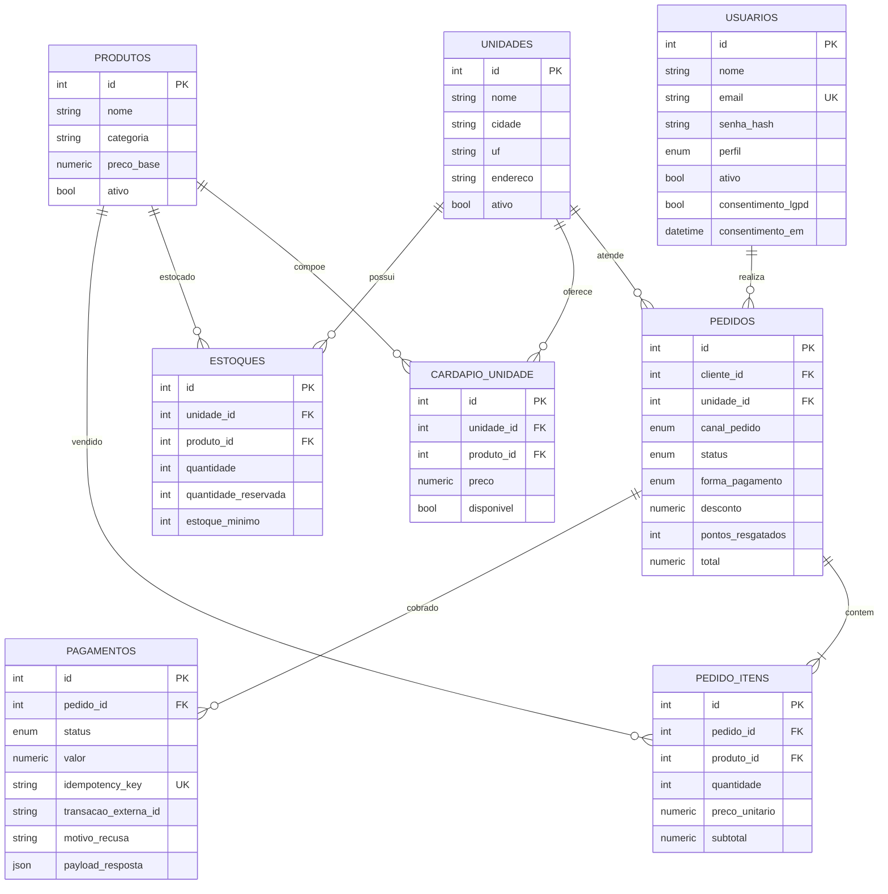
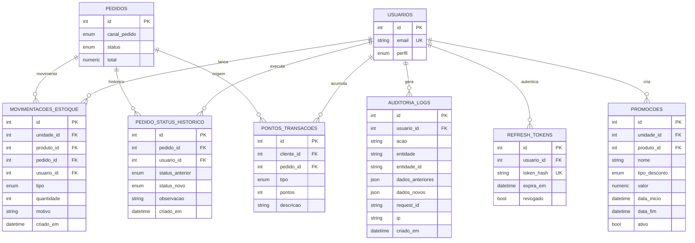

# DER — Diagrama Entidade-Relacionamento

O modelo tem 14 tabelas. Para manter legibilidade, o DER está dividido em dois recortes:
o **núcleo comercial** (pedido, cardápio, estoque e pagamento) e o **apoio operacional e
governança** (movimentações, fidelidade, promoções, histórico, auditoria e sessões).

## Núcleo comercial

## Apoio operacional e governança

## Restrições relevantes

| Restrição | Tabela | Motivo |
|---|---|---|
| `UNIQUE(email)` | usuarios | impedir cadastro duplicado |
| `UNIQUE(unidade_id, produto_id)` | cardapio_unidade, estoques | um item por unidade |
| `CHECK(quantidade_reservada <= quantidade)` | estoques | reserva nunca maior que o saldo físico |
| `CHECK(total >= 0)` | pedidos | total líquido não negativo |
| `UNIQUE(idempotency_key)` | pagamentos | retry de pagamento não duplica cobrança |
| `UNIQUE(pedido_id, tipo)` | pontos_transacoes | um crédito e um débito por pedido |
| `CHECK(quantidade > 0)` | pedido_itens, movimentacoes_estoque | quantidade sempre positiva |
| FK com `ON DELETE CASCADE` | pedido_itens, pagamentos, pedido_status_historico, refresh_tokens | filhos não sobrevivem ao pai |
