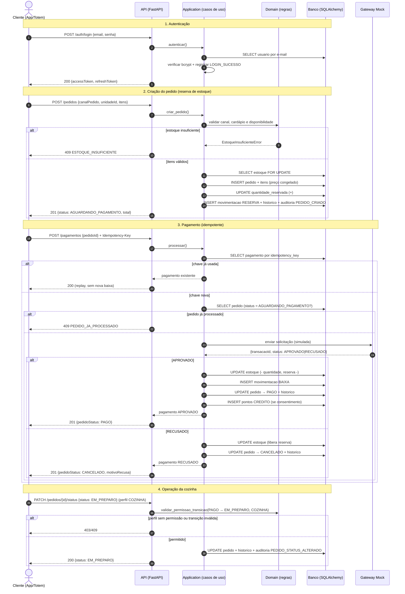

# Diagrama de Sequência — Pedido → Pagamento Mock → Status

## Pontos de controle demonstrados

| Ponto | Como aparece no diagrama |
|---|---|
| Multicanalidade | `canalPedido` entra no passo 2 e é persistido |
| Consistência de estoque | `SELECT ... FOR UPDATE` antes de reservar/baixar |
| Idempotência | consulta por `idempotency_key` antes de qualquer efeito |
| Recusa coerente | pedido `CANCELADO` + reserva liberada, sem pontos |
| Autorização por perfil | validação da matriz de transições no passo 4 |
| Rastreabilidade | `requestId` gravado em cada `INSERT` de auditoria |
