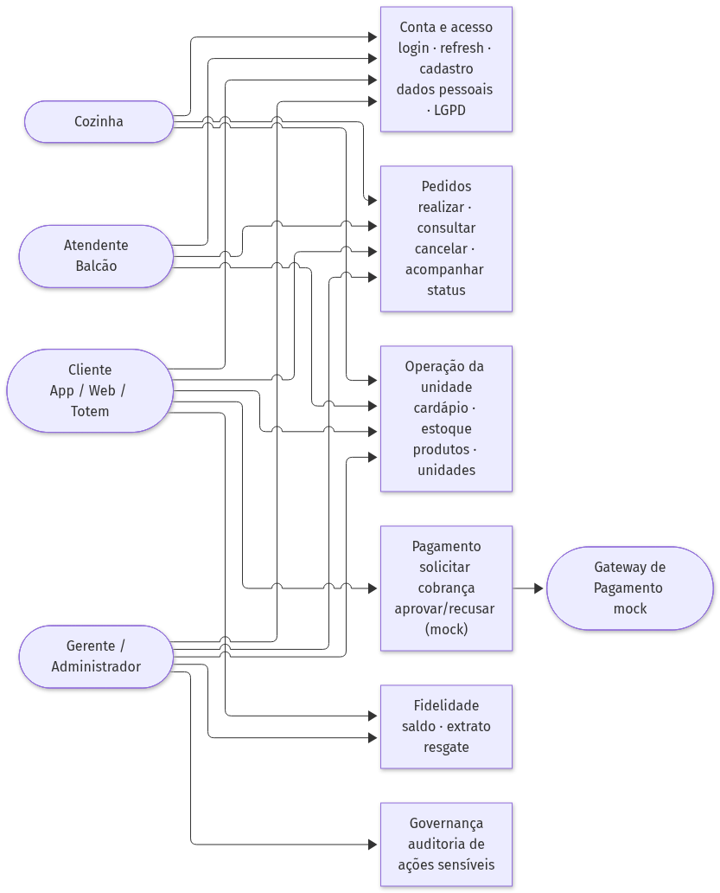
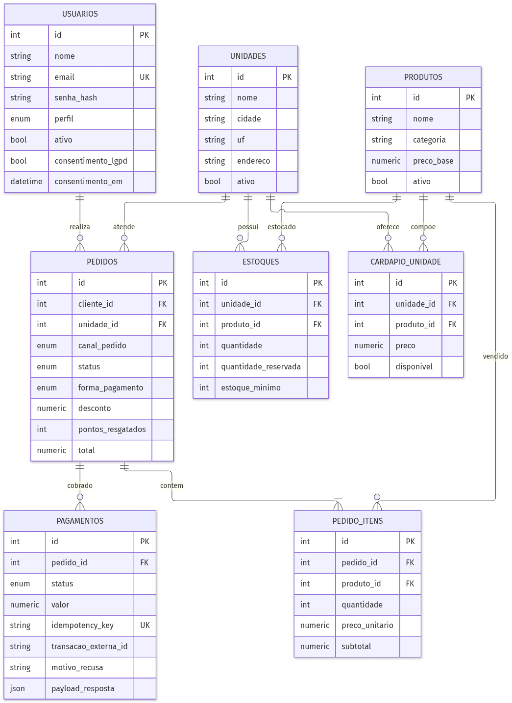
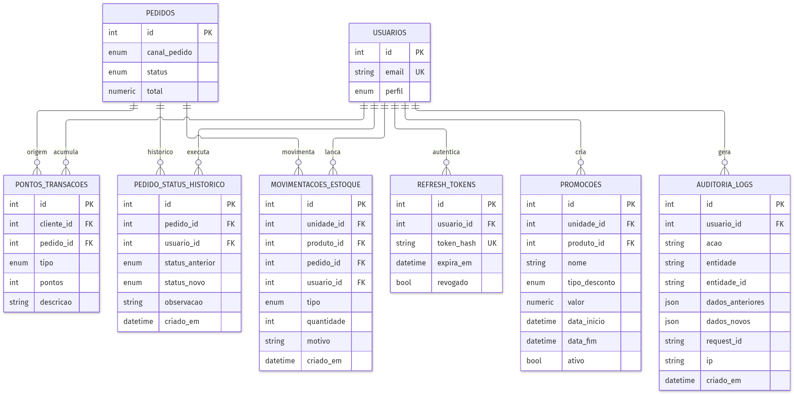
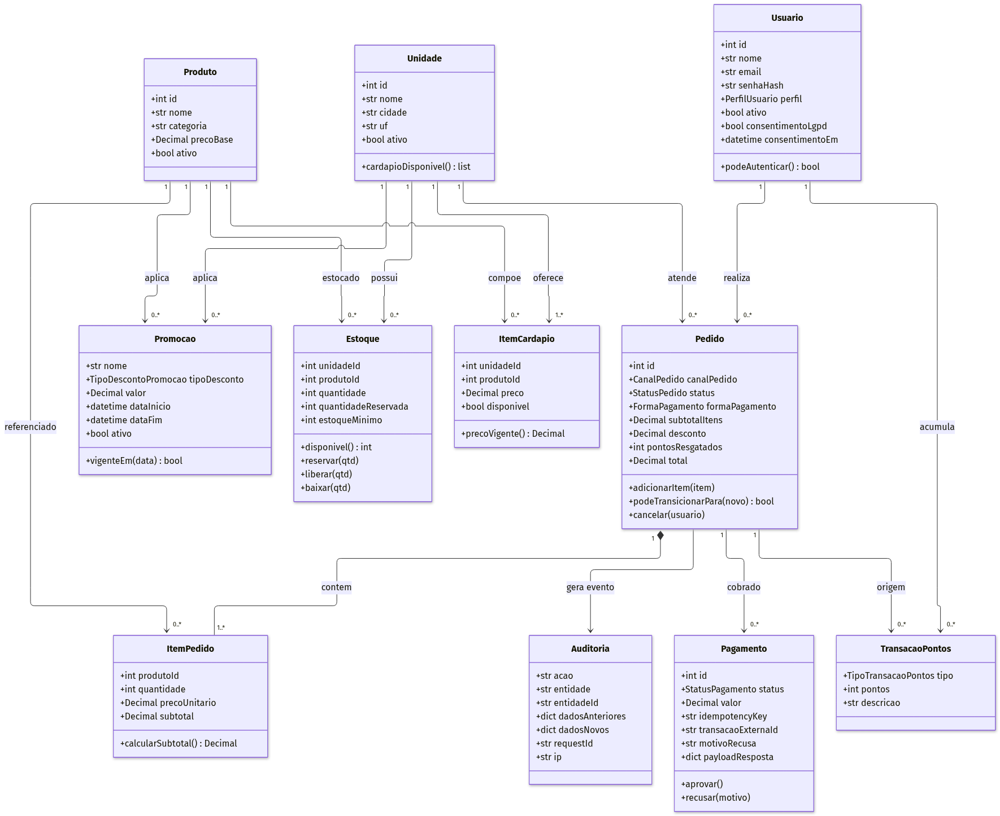
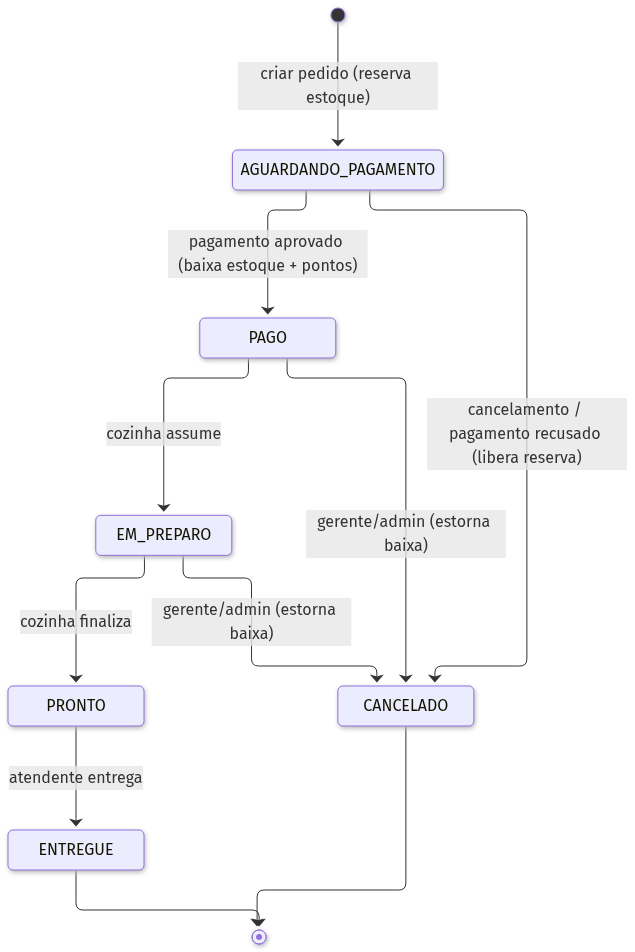
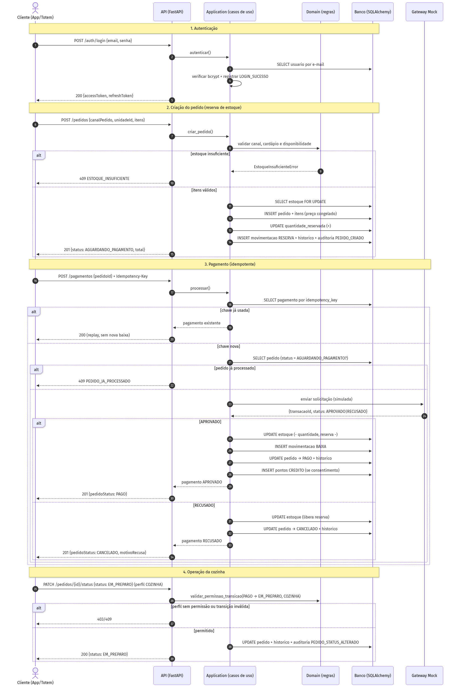
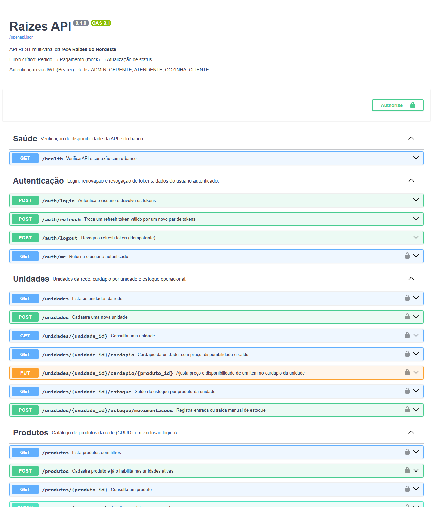

<!--CAPA-->

<div class="page-break"></div>

# RESUMO

Este trabalho apresenta o projeto e a implementação do back-end de uma solução multicanal para a rede
de lanchonetes fictícia **Raízes do Nordeste**. O problema de negócio é a operação de uma franquia em
expansão, que precisa atender o mesmo pedido por canais distintos — aplicativo, totem, balcão,
pick-up e web — mantendo cardápio e estoque próprios de cada unidade e sem perder rastreabilidade.

A solução foi construída em **Python 3.12 com FastAPI**, persistência em **SQLAlchemy 2.0** com
migrações versionadas em **Alembic**, autenticação **JWT** com autorização por perfis, documentação
**OpenAPI** gerada a partir do código e banco **SQLite** portável para PostgreSQL por configuração.
A organização segue quatro camadas — *Domain*, *Application*, *Infrastructure* e *API* — com regras de
negócio isoladas de framework e de banco de dados.

O fluxo crítico entregue ponta a ponta é **Pedido → Pagamento (mock) → Atualização de status**:
o pedido registra obrigatoriamente o canal de origem (`canalPedido`), reserva o estoque da unidade,
tem o pagamento solicitado a um gateway simulado com chave de idempotência, e só então converte a
reserva em baixa física, credita pontos de fidelidade e avança na máquina de estados. A recusa de
pagamento libera a reserva e encerra o pedido de forma coerente.

Foram implementadas 34 operações de API em 14 tabelas, com padrão único de erro, paginação em todas
as listagens e mensagens de validação em português. A LGPD é tratada de forma técnica: consentimento
registrado com data, minimização nas respostas, hash bcrypt de senha, log append-only de ações
sensíveis, portabilidade dos dados do titular e anonimização na exclusão da conta. A validação é
reproduzível por meio de uma coleção Postman com 61 requisições e 27 cenários documentados
(8 positivos e 19 negativos), executada integralmente com sucesso em banco recém-semeado.

**Palavras-chave:** API REST; FastAPI; multicanalidade; estoque por unidade; pagamento simulado; LGPD.

<div class="page-break"></div>

# SUMÁRIO

<!--SUMARIO-->

<div class="page-break"></div>

# 1 INTRODUÇÃO E OBJETIVOS

A **Raízes do Nordeste** é uma rede de lanchonetes de comida regional em expansão, com unidades em
capitais e no interior. O crescimento trouxe um problema típico de franquia: cada loja tem
disponibilidade própria de produtos e estoque próprio, mas o cliente espera a mesma experiência
independentemente de onde pede. Além disso, o mesmo pedido pode nascer em canais diferentes — o
aplicativo, o totem da loja, o balcão, o pick-up ou o site — e a operação precisa saber de onde ele
veio para conseguir consolidar demanda por canal.

O objetivo deste trabalho é projetar e implementar o **back-end** dessa solução, demonstrando
domínio sobre levantamento e priorização de requisitos, modelagem de dados, definição de contratos
de API, implementação de regras de negócio, segurança, conformidade com a LGPD e testabilidade.

Os objetivos específicos são:

1. traduzir o estudo de caso em requisitos funcionais e não funcionais priorizados;
2. modelar o domínio e o banco em DER coerente com a implementação;
3. organizar o código em camadas, separando regra de negócio de detalhe técnico;
4. implementar uma API REST documentada via OpenAPI, com contrato e padrão de erro consistentes;
5. fechar um fluxo crítico completo com persistência real e integração simulada de pagamento;
6. aplicar controles mínimos de segurança e LGPD, com rastreabilidade por auditoria;
7. entregar evidência reproduzível de funcionamento por meio de coleção de testes.

O escopo escolhido — **Fluxo A: Pedido → Pagamento mock → Atualização de status** — é o recomendado
pelo roteiro e é o que exercita o maior número de regras simultâneas: multicanalidade, consistência
de estoque, idempotência, máquina de estados, autorização por perfil e fidelização.

<div class="page-break"></div>

# 2 ANÁLISE E REQUISITOS

## 2.1 Contexto do negócio

A rede opera com uma matriz (que define catálogo, preços de referência e campanhas) e unidades
(que vendem, preparam e entregam). Disso decorrem três restrições estruturais que guiaram todo o
modelo:

- **estoque é por unidade**, não global: uma promoção pode esgotar em uma loja e continuar
  disponível em outra;
- **preço é por unidade**, ainda que derivado do preço base da matriz;
- **o canal de origem é dado de domínio**, não um detalhe de interface: precisa ser gravado,
  consultável e filtrável.

## 2.2 Requisitos funcionais

| ID | Requisito funcional | Situação |
|---|---|---|
| RF01 | Cadastro de usuário com e-mail único e consentimento LGPD (restrito a ADMIN) | Implementado |
| RF02 | Autenticação por e-mail e senha com emissão de token JWT e refresh rotativo | Implementado |
| RF03 | Autorização por perfis: ADMIN, GERENTE, ATENDENTE, COZINHA, CLIENTE | Implementado |
| RF04 | Cadastro e consulta de unidades da rede | Implementado |
| RF05 | CRUD de produtos com desativação lógica | Implementado |
| RF06 | Cardápio por unidade, com preço e disponibilidade próprios | Implementado |
| RF07 | Controle de estoque por unidade, com entrada/saída e restrição de venda | Implementado |
| RF08 | Criação de pedido multicanal com itens, valores e status inicial | Implementado |
| RF09 | Registro obrigatório do canal do pedido (`canalPedido`) e filtro por canal | Implementado |
| RF10 | Atualização de status com máquina de estados e permissão por perfil | Implementado |
| RF11 | Cancelamento de pedido com devolução de reserva/estoque | Implementado |
| RF12 | Solicitação de pagamento a serviço externo simulado (mock) com registro de retorno | Implementado |
| RF13 | Programa de fidelização: acúmulo, saldo, extrato e resgate | Implementado |
| RF14 | Promoções e campanhas | Modelado e documentado (regra de aplicação não aplicada ao total) |
| RF15 | Portabilidade e eliminação de dados pessoais pelo titular | Implementado |
| RF16 | Consulta de log de auditoria por administrador | Implementado |

## 2.3 Requisitos não funcionais

| ID | Requisito não funcional | Como foi atendido |
|---|---|---|
| RNF01 | Segurança de credenciais | senha com bcrypt; hash nunca retorna em resposta |
| RNF02 | Autenticação e autorização | JWT HS256 de curta duração; refresh token rotativo persistido só como hash |
| RNF03 | Privacidade (LGPD) | consentimento com carimbo de tempo, minimização, mascaramento de e-mail em log de falha |
| RNF04 | Rastreabilidade | `requestId` por requisição (header e log), IP e trilha de status do pedido |
| RNF05 | Consistência sob concorrência | reserva de estoque com `SELECT ... FOR UPDATE` e transação curta |
| RNF06 | Tolerância a falhas na integração | pagamento com `Idempotency-Key`: retry não duplica baixa nem pontos |
| RNF07 | Disponibilidade / desempenho | SQLite em modo WAL; consultas paginadas; ausência de N+1 nas listagens de pedido |
| RNF08 | Portabilidade de banco | enums como VARCHAR com CHECK; `DATABASE_URL` troca SQLite por PostgreSQL |
| RNF09 | Documentação executável | OpenAPI gerado do código, sem contrato paralelo sujeito a divergência |
| RNF10 | Testabilidade | coleção Postman com asserções e plano de testes com cenários positivos e negativos |

## 2.4 Multicanalidade como requisito de domínio

O canal não é um parâmetro de rastreio opcional: é parte do pedido. A implementação trata os três
pontos exigidos pelo roteiro:

1. **Campo de domínio tipado** — `canal_pedido` é um ENUM com `APP`, `TOTEM`, `BALCAO`, `PICKUP`
   e `WEB`, persistido como `VARCHAR` com `CHECK`, e obrigatório na criação.
2. **Validação no contrato** — a ausência do campo retorna `422 DADOS_INVALIDOS` com
   `details[].field = "canalPedido"`; valor fora do enum retorna `422` listando as opções válidas.
3. **Consulta por canal** — `GET /pedidos?canalPedido=TOTEM` filtra a listagem, e o campo é
   auditado na criação (`PEDIDO_CRIADO` guarda o canal no payload do log).

## 2.5 Priorização: entregue, proposto e justificativas

O roteiro pede priorização explícita entre o que foi implementado e o que ficou proposto. A decisão
foi guiada por um critério: **o que fecha o fluxo crítico de forma verificável**.

| Frente | Decisão | Justificativa |
|---|---|---|
| Pedido + pagamento mock + status | Entregue completo | é o fluxo crítico recomendado; sem ele a nota de implementação cai para a faixa mínima |
| Multicanalidade (`canalPedido`) | Entregue completo | requisito de domínio explícito, de baixo custo e alto impacto na avaliação |
| Estoque por unidade | Entregue completo | é o que dá sentido à reserva; sem ele não existe 409 de negócio |
| Fidelização | Entregue (acúmulo, extrato, resgate) | requisito obrigatório e demonstra regra de negócio com restrição de consentimento |
| LGPD operacional | Entregue (consentimento, portabilidade, anonimização) | o roteiro exige demonstração, não citação |
| Auditoria | Entregue, inclusive consulta por ADMIN | transforma "log" em evidência verificável na API |
| Promoções | Modelado, regra documentada, não aplicada ao total | o roteiro aceita "ao menos como regra"; preferiu-se fechar o fluxo crítico a abrir uma frente incompleta |
| Interface/webhook real de gateway | Proposto | fora do escopo do mock, que é o que o roteiro pede |
| Reserva com expiração automática (TTL) | Proposto | exigiria job agendado; mitigado cancelando o pedido na recusa |
| Deploy público | Proposto | o roteiro aceita execução local reproduzível |

<div class="page-break"></div>

# 3 DIAGRAMAS, MODELAGEM E ARQUITETURA

## 3.1 Diagrama de casos de uso



<p class="esquerda">Atores: Cliente (App/Web/Totem), Atendente (balcão), Cozinha, Gerente/Administrador e
Gateway de Pagamento (sistema externo simulado). Para preservar a legibilidade dos rótulos no PDF,
os casos de uso aparecem agrupados por área de funcionalidade; a relação completa de casos por área
está em <code>docs/diagramas/casos-de-uso.md</code>, que acompanha o repositório.</p>

### 3.1.1 Descrição do caso de uso crítico — Realizar Pedido + Solicitar Pagamento

**Descrição:** o cliente monta um pedido em um dos canais, o sistema reserva o estoque da unidade e
envia a solicitação de pagamento ao gateway simulado, que aprova ou recusa.

**Ator principal:** Cliente. **Atores secundários:** Gateway de Pagamento (mock).

**Pré-condições:** usuário autenticado; unidade ativa; produto ativo e presente no cardápio da
unidade; saldo de estoque suficiente.

**Pós-condições:** aprovado — pedido `PAGO`, estoque baixado, pontos creditados se houver
consentimento; recusado — pedido `CANCELADO`, reserva liberada, sem pontos.

**Fluxo base:**

1. Cliente envia `POST /pedidos` com `canalPedido`, `unidadeId` e itens.
2. Sistema valida canal, unidade, produto, cardápio e disponibilidade.
3. Sistema congela o preço do cardápio e calcula o subtotal; aplica resgate se solicitado.
4. Sistema reserva o estoque e cria o pedido em `AGUARDANDO_PAGAMENTO`.
5. Cliente envia `POST /pagamentos` com `Idempotency-Key`.
6. Gateway mock devolve transação aprovada.
7. Sistema converte reserva em baixa, move o pedido para `PAGO` e credita pontos.
8. Cliente acompanha por `GET /pedidos/{id}`.

**Fluxos de exceção:** `422` para payload inválido (inclusive `canalPedido` ausente); `404` para
unidade, produto ou estoque inexistente; `409` para produto indisponível ou estoque insuficiente;
`409` para pedido já processado; `200` para replay idempotente.

**Regras de negócio:** RN1 canal obrigatório e rastreável; RN2 total calculado no servidor;
RN3 reserva só vira baixa com pagamento aprovado; RN4 idempotência impede duplicidade;
RN5 resgate exige consentimento e múltiplos de 100 pontos.

## 3.2 DER e modelo de dados



*Figura 3.2 — Núcleo comercial: pedido, cardápio por unidade, estoque e pagamento.*



*Figura 3.3 — Apoio operacional e governança: movimentações de estoque, fidelidade, promoções,
histórico de status, auditoria e refresh tokens.*

Os dois recortes acima constituem o **modelo entidade-relacionamento (MER)**: entidades, atributos,
relacionamentos e cardinalidades. O **modelo lógico** correspondente — com tipo de dado,
nulabilidade e chaves de cada coluna — está no **Apêndice E (dicionário de dados)**.

O modelo tem **14 tabelas**. As decisões estruturais mais relevantes:

| Entidade | Papel | Decisão |
|---|---|---|
| `usuarios` | identidade e perfil | e-mail único; senha em hash; consentimento com data |
| `unidades` | lojas da rede | isolamento de operação |
| `produtos` | catálogo da rede | preço base de referência |
| `cardapio_unidade` | preço e disponibilidade por loja | N:N com atributos — atende "cardápio por unidade" |
| `estoques` | saldo físico e reservado por loja | `CHECK(reservada <= quantidade)` |
| `movimentacoes_estoque` | histórico append-only | ENTRADA/SAIDA/RESERVA/LIBERACAO/BAIXA |
| `pedidos` | cabeçalho multicanal | `canal_pedido`, `desconto`, `pontos_resgatados` |
| `pedido_itens` | itens com preço congelado | preço vem do cardápio no momento da compra |
| `pagamentos` | cobrança desacoplada | `UNIQUE(idempotency_key)`, payload do gateway em JSON |
| `pedido_status_historico` | trilha de status | quem, quando, de qual para qual |
| `pontos_transacoes` | extrato de fidelidade | `UNIQUE(pedido_id, tipo)` impede crédito duplicado |
| `promocoes` | campanhas | escopo opcional por unidade/produto e vigência |
| `auditoria_logs` | log de ações sensíveis | sem update/delete pela aplicação |
| `refresh_tokens` | sessão de longa duração | apenas hash SHA-256, com revogação |

## 3.3 Arquitetura em camadas

```
app/
├── domain/          # enums, exceções e regras puras (sem FastAPI, sem SQLAlchemy)
├── application/     # casos de uso: orquestram transação, repositório e auditoria
├── infrastructure/  # SQLAlchemy, Alembic, repositórios, JWT/bcrypt, seed
└── api/             # routers, schemas Pydantic, dependências, tratamento de erro
```

A dependência aponta sempre para dentro: `api → application → domain`, e `infrastructure`
implementa o que as camadas internas precisam. Consequências práticas:

- as regras de transição de status e o cálculo de pontos são funções puras, testáveis sem banco;
- trocar SQLite por PostgreSQL não altera nenhuma camada acima de `infrastructure`;
- a documentação OpenAPI deriva dos schemas da borda, então contrato e implementação não divergem.

## 3.4 Diagrama de classes e máquina de estados





A matriz de transições é aplicada no servidor, não na interface:

| Transição | Perfis autorizados |
|---|---|
| `AGUARDANDO_PAGAMENTO → PAGO` | sistema (pagamento), ADMIN, GERENTE, ATENDENTE |
| `AGUARDANDO_PAGAMENTO → CANCELADO` | CLIENTE (próprio pedido), ATENDENTE, GERENTE, ADMIN |
| `PAGO → EM_PREPARO` | COZINHA, GERENTE, ADMIN |
| `PAGO → CANCELADO` | GERENTE, ADMIN |
| `EM_PREPARO → PRONTO` | COZINHA, GERENTE, ADMIN |
| `EM_PREPARO → CANCELADO` | GERENTE, ADMIN |
| `PRONTO → ENTREGUE` | ATENDENTE, GERENTE, ADMIN |

## 3.5 Diagrama de sequência do fluxo crítico



O diagrama evidencia três pontos de controle: `SELECT ... FOR UPDATE` antes de alterar saldo,
consulta por `idempotency_key` antes de qualquer efeito e validação da matriz de transições antes
de mudar status.

<div class="page-break"></div>

# 4 API E ENDPOINTS

## 4.1 Organização por recurso

| Recurso | Operações | Autenticação |
|---|---|---|
| `/auth` | login, refresh, logout, me | público / JWT |
| `/usuarios` | cadastro, me, me/dados, me (PATCH/DELETE), listagem | JWT / ADMIN no cadastro |
| `/unidades` | listar, detalhar, criar, cardápio, estoque, movimentação | JWT / gestão |
| `/produtos` | listar, detalhar, criar, atualizar, desativar | JWT / gestão |
| `/pedidos` | criar, listar com filtros, detalhar, atualizar status, pagamentos | JWT |
| `/pagamentos` | solicitar (idempotente), detalhar | JWT |
| `/fidelidade` | saldo, extrato, regras | JWT |
| `/auditoria` | consultar log | ADMIN |
| `/health` | disponibilidade | público |

Todas as listagens são paginadas no envelope `{ "data": [...], "meta": { page, limit, total, totalPages } }`,
com `limit` entre 1 e 100.

## 4.2 Padrão de erro

Toda falha — de validação, de negócio, de autorização ou interna — responde no mesmo formato:

```json
{
  "error": "ESTOQUE_INSUFICIENTE",
  "message": "Não há quantidade suficiente para um ou mais itens.",
  "details": [{ "field": "itens", "issue": "Produto 1: solicitado 999, disponível 20" }],
  "timestamp": "2026-02-05T12:00:00Z",
  "path": "/pedidos",
  "requestId": "3f1c0a7d9e2b4c5f8a6d1e2f3a4b5c6d"
}
```

O mesmo `requestId` retorna no header `X-Request-ID` e é gravado na auditoria, permitindo ligar uma
resposta ao registro correspondente. Mensagens de validação são traduzidas para português; nenhum
texto do validador vaza para o contrato.

## 4.3 Contrato de pedido e o campo canalPedido

Requisição de criação (trecho do roteiro, atendido integralmente):

```json
{
  "canalPedido": "TOTEM",
  "unidadeId": 2,
  "itens": [
    { "produtoId": 2, "quantidade": 2 },
    { "produtoId": 7, "quantidade": 1 }
  ],
  "formaPagamento": "MOCK",
  "resgatarPontos": false
}
```

Resposta `201`:

```json
{
  "id": 2,
  "clienteId": 5,
  "unidadeId": 2,
  "canalPedido": "TOTEM",
  "status": "AGUARDANDO_PAGAMENTO",
  "formaPagamento": "MOCK",
  "subtotalItens": 31.5,
  "desconto": 0,
  "pontosResgatados": 0,
  "total": 31.5,
  "itens": [
    { "produtoId": 2, "nome": "Pastel de Carne de Sol", "quantidade": 2, "precoUnitario": 12.0, "subtotal": 24.0 },
    { "produtoId": 7, "nome": "Suco de Cajá", "quantidade": 1, "precoUnitario": 7.5, "subtotal": 7.5 }
  ]
}
```

Ausência ou valor inválido de `canalPedido` produzem `422` com `details[].field = "canalPedido"`,
conforme exigido no item 5.5 do roteiro.

## 4.4 Exemplos de requisição e resposta

**Login** — `POST /auth/login` (público)

```json
{ "email": "cliente@raizes.com.br", "senha": "Senha@123" }
```

`200`:

```json
{
  "accessToken": "eyJhbGciOiJIUzI1NiIsInR5cCI6IkpXVCJ9...",
  "refreshToken": "7D6pE3afzMt0P0V...",
  "tokenType": "Bearer",
  "expiresIn": 3600,
  "user": { "id": 5, "nome": "Maria Cliente", "perfil": "CLIENTE" }
}
```

**Pagamento mock** — `POST /pagamentos` (header `Idempotency-Key` obrigatório)

```json
{ "pedidoId": 2, "simularResultado": "APROVADO" }
```

`201`:

```json
{
  "id": 1,
  "pedidoId": 2,
  "pedidoStatus": "PAGO",
  "status": "APROVADO",
  "valor": 31.5,
  "formaPagamento": "MOCK",
  "idempotencyKey": "pedido-2-pagamento-1",
  "transacaoExternaId": "mock_5f1c2a9b7e3d4c8a",
  "motivoRecusa": null,
  "payloadResposta": { "simulado": true, "status": "APROVADO", "valor": "31.50" },
  "criadoEm": "2026-11-20T22:05:03Z",
  "processadoEm": "2026-11-20T22:05:03Z"
}
```

**Erro de negócio** — `409`

```json
{
  "error": "ESTOQUE_INSUFICIENTE",
  "message": "Não há quantidade suficiente para um ou mais itens.",
  "details": [{ "field": "itens", "issue": "Produto 1: solicitado 999, disponível 20" }],
  "timestamp": "2026-11-20T22:05:03Z",
  "path": "/pedidos",
  "requestId": "a9b5c3e1d71d4788b529c78d9a4ed71a"
}
```

## 4.5 Regras mínimas de contrato

| Regra do roteiro | Aplicação |
|---|---|
| URLs no plural | `/produtos`, `/pedidos`, `/usuarios`, `/unidades` |
| IDs no path | `/pedidos/{id}`, `/unidades/{id}/estoque` |
| Paginação em listagens | `?page=1&limit=10` em todas |
| Status code coerente | 200, 201, 204, 401, 403, 404, 409, 422 |
| Erro padronizado | mesmo JSON em qualquer falha |
| `canalPedido` no contrato | obrigatório, validado e filtrável |

<div class="page-break"></div>

# 5 LGPD, PRIVACIDADE E SEGURANÇA

## 5.1 Dados pessoais tratados

| Dado | Finalidade | Base legal | Armazenamento |
|---|---|---|---|
| nome, e-mail, telefone | identificação, contato e entrega | execução de contrato (art. 7º, V) | `usuarios` |
| senha | autenticação | execução de contrato | `usuarios.senha_hash` (bcrypt) |
| histórico de pedidos | obrigação fiscal e suporte | obrigação legal (art. 7º, II) | `pedidos`, `pedido_itens` |
| pontos de fidelidade | programa de vantagens | consentimento (art. 7º, I) | `pontos_transacoes` |
| IP e requestId | segurança e rastreabilidade | legítimo interesse (art. 7º, IX) | `auditoria_logs` |

O consentimento é registrado em dois campos (`consentimento_lgpd` booleano e `consentimento_em`
com data e hora), e o resgate de fidelidade é bloqueado quando ele não está vigente.

## 5.2 Controles implementados

- **Credenciais:** bcrypt com salt; hash nunca retorna em resposta nem em log.
- **Autenticação:** JWT HS256 com expiração de 60 minutos; refresh token rotativo, persistido
  somente como SHA-256 e revogado a cada uso, no logout e na anonimização.
- **Autorização:** dependência `require_perfis` por endpoint e matriz de transições por perfil.
- **Minimização:** o resumo de usuário retorna apenas `id`, `nome` e `perfil`; o e-mail em falha de
  login é mascarado (`cl***@raizes.com.br`); respostas de erro não expõem stack trace.
- **Integridade do contrato:** validação de entrada na borda (Pydantic) e de regra no domínio,
  impedindo que o cliente envie total, preço ou status.
- **Auditoria append-only:** registro de login, leitura de dados pessoais, exportação,
  anonimização, criação de pedido, mudança de status, pagamento e movimentação de estoque, com
  `requestId` e IP.

## 5.3 Retenção e eliminação

| Dado | Retenção | Ação |
|---|---|---|
| Conta e dados cadastrais | enquanto ativa ou até solicitação | `DELETE /usuarios/me` → anonimização |
| Pedidos e pagamentos | 5 anos (fiscal/contábil) | mantidos, sem vínculo com dados pessoais |
| Logs de auditoria | 12 meses | append-only, sem payload sensível |
| Refresh tokens | 7 dias | expiração e revogação |

A anonimização substitui o nome por "Titular anonimizado", troca o e-mail por endereço sintético em
domínio reservado (`anonimizado+{id}@removido.invalid`), limpa o telefone, invalida a senha com hash
aleatório descartado, revoga tokens e marca a conta como inativa — preservando os pedidos para a
obrigação legal, sem vínculo com a pessoa identificada.

## 5.4 Evidência de auditoria

A consulta `GET /auditoria?acao=PEDIDO_CRIADO` (ADMIN) devolve os registros com `requestId`, IP e
payload resumido, comprovando pela própria API que ações sensíveis geram rastro. As ações
registradas são: `LOGIN_SUCESSO`, `LOGIN_FALHA`, `LOGIN_BLOQUEADO`, `TOKEN_RENOVADO`, `LOGOUT`,
`USUARIO_CADASTRADO`, `USUARIO_ATUALIZADO`, `LEITURA_DADOS_PESSOAIS`, `EXPORTACAO_DADOS_PESSOAIS`,
`LGPD_ANONIMIZACAO`, `PEDIDO_CRIADO`, `PEDIDO_STATUS_ALTERADO`, `PAGAMENTO_APROVADO`,
`PAGAMENTO_RECUSADO`, `ESTOQUE_MOVIMENTADO`, `PRODUTO_CRIADO`, `PRODUTO_ATUALIZADO`,
`PRODUTO_DESATIVADO`, `UNIDADE_CRIADA` e `CARDAPIO_ATUALIZADO`.

<div class="page-break"></div>

# 6 ENTREGA TÉCNICA

## 6.1 Repositório e execução

| Item | Valor |
|---|---|
| Repositório | https://github.com/HTAss01/raizes-api (público) |
| Linguagem | Python 3.11+ (validado em 3.12) |
| Banco | SQLite por padrão; PostgreSQL via `DATABASE_URL` |
| Migrações | Alembic (`alembic upgrade head`) |
| Seed | `python -m app.infrastructure.db.seed` |
| API | `uvicorn app.main:app --reload --port 8000` |

O `README.md` do repositório contém o passo a passo completo: requisitos, `.env.example`,
instalação, criação do banco, migrations, seed, execução, acesso ao Swagger, execução dos testes e
credenciais de cada perfil.

## 6.2 Documentação da API

- Swagger UI: `http://localhost:8000/docs`
- OpenAPI JSON: `http://localhost:8000/openapi.json`

A especificação é **gerada a partir do código**, com exemplos de requisição nos schemas de entrada
e todos os códigos de status declarados por endpoint. Não existe documento paralelo que possa
divergir da implementação.

{ .figura-api }

*Figura 6.1 — Swagger UI em execução local: endpoints agrupados por recurso, esquema de autenticação
BearerAuth e contratos gerados do código.*

## 6.3 Coleção de testes

`docs/postman/Raizes-API.postman_collection.json` — 10 pastas, 61 requisições, com asserções
(`pm.test`) e encadeamento de variáveis (`accessToken`, `pedidoId`, `pagamentoId`,
`idempotencyKey`). O environment `docs/postman/Raizes-API.postman_environment.json` define a URL
base.

## 6.4 Modelo de dados e migrations

Duas migrations versionadas: `aa96efa3354d` (esquema inicial com 14 tabelas) e `7ca84e9e7cc6`
(colunas `desconto` e `pontos_resgatados` em `pedidos`, com `server_default` para compatibilidade
com SQLite). O DER entregue em `docs/diagramas/der.md` corresponde exatamente ao banco criado pelas
migrations.

## 6.5 Histórico de commits

O repositório tem histórico incremental, com commits temáticos que evoluem do ambiente para o
domínio, deste para a persistência, e assim por diante até documentação e testes. Isso permite
reconstruir a ordem de raciocínio do projeto, e não apenas o resultado final.

<div class="page-break"></div>

# 7 PLANO DE TESTES

O plano completo está em `docs/PLANO_DE_TESTES.md`, com 27 cenários identificados (T01 a T27) e
respectiva evidência no nome da requisição da coleção. Resumo por categoria:

| Categoria | Cenários | Exemplos |
|---|---|---|
| Autenticação e autorização | 6 | login válido, sem token (401), perfil sem permissão (403), cadastro por GERENTE (403) |
| Validação de dados | 5 | campo obrigatório, enum inválido, header ausente, consentimento e perfil ausentes |
| Regras de negócio | 7 | pedido criado (201), estoque insuficiente (409), transição inválida (409) |
| Pagamento mock | 3 | aprovado, recusado, replay idempotente |
| Fidelidade, LGPD e auditoria | 6 | resgate sem saldo, cadastro, duplicidade, portabilidade, anonimização, auditoria |

**Cobertura mínima exigida pelo roteiro:** login com token (T01); acesso sem token (T03); perfil sem
permissão (T04, T06, T23, T26); campo obrigatório ausente (T08, T16, T20, T27); formato inválido (T09); pedido
criado (T07); recurso inexistente (T05); estoque insuficiente (T10); pagamento aprovado com mudança
de status (T13); pagamento recusado (T15); log de ação sensível (T22).

**Como reproduzir:** importar coleção e environment no Postman, selecionar `Raizes API - Local`,
abrir o Collection Runner e executar a coleção completa em banco recém-semeado. As variáveis são
encadeadas em sequência, na ordem das pastas `00` a `09`.

<div class="page-break"></div>

# 8 RESULTADOS OBTIDOS

Os números abaixo foram medidos em execução real, contra banco criado por `alembic upgrade head` e
populado pelo seed:

| Métrica | Resultado |
|---|---|
| Tabelas de domínio | 14 (+ `alembic_version`) |
| Operações de API publicadas | 34 |
| Coleção Postman | 61 requisições em 10 pastas |
| Execução completa da coleção | 61/61 com status esperado, zero falha |
| Cenários documentados | 27 (8 positivos, 19 negativos) |
| Pontos de auditoria gerados na execução | 20 tipos de ação |
| Migrations | 2 |

Comportamentos verificados que traduzem regra de negócio, e não apenas CRUD:

- reserva de estoque reduz o disponível na criação (`40 → 38`) e a baixa ocorre só na aprovação;
- replay da mesma `Idempotency-Key` devolve `200` com o mesmo pagamento, sem segunda baixa nem
  segundo crédito de pontos;
- pagamento recusado libera a reserva e leva o pedido a `CANCELADO`, sem creditar pontos;
- cancelamento devolve o saldo exatamente ao valor anterior (`40 → 40`);
- cozinha não consegue pular de `AGUARDANDO_PAGAMENTO` para `EM_PREPARO` (`409`);
- segundo cliente recebe `403` ao tentar consultar ou pagar pedido alheio;
- após anonimização, o token antigo retorna `401` e o login com as credenciais originais também;
- `GET /usuarios` continua funcionando normalmente depois de uma anonimização — defeito encontrado
  durante os testes e corrigido antes da entrega (validação de e-mail na saída rejeitava o domínio
  reservado usado na anonimização).

<div class="page-break"></div>

# 9 CRITÉRIOS DE ENTREGA E NORMAS ABNT

O trabalho é entregue em **arquivo único PDF** (`4992316_Projeto_Back_End.pdf`), nomeado com o
RU seguido de *Projeto Back End*, conforme o roteiro. A formatação segue a NBR 14724 para
apresentação de trabalhos acadêmicos e a NBR 6023 para referências:

| Elemento | Aplicação |
|---|---|
| Papel e margens | A4; margens de 3 cm (superior e esquerda) e 2 cm (inferior e direita) |
| Fonte | Times New Roman, corpo 12; citações longas e notas em 10; legendas em 10 |
| Espaçamento | 1,5 no corpo do texto; simples nas referências, separadas por linha em branco |
| Paginação | algarismos arábicos no rodapé, alinhados à direita; contagem iniciada na folha de rosto, com número exibido a partir da introdução (NBR 14724) |
| Estrutura | capa, folha de rosto, resumo, sumário, seções numeradas, referências e apêndices |
| Sumário | títulos numerados com indicação das páginas correspondentes |
| Ilustrações | figuras de diagramas com legenda e referência no texto |

Além do PDF, a entrega compreende o **repositório público** com código-fonte, histórico de
commits, README de execução, migrações e seed, a **documentação OpenAPI** gerada pela própria
aplicação, a **coleção Postman** com os cenários de teste e o **DER** em imagem e em código
Mermaid. Todos os links constam no README do repositório, conforme exigido no item 7.3 do roteiro.

O texto foi redigido com postura profissional: cada decisão técnica é justificada, os limites da
versão atual estão declarados de forma explícita e os números apresentados foram medidos em
execução real da API, não estimados.

## 9.1 Declaração de uso de ferramentas de inteligência artificial

Durante o desenvolvimento deste trabalho, ferramentas de inteligência artificial foram utilizadas
exclusivamente como apoio, em duas frentes: no esclarecimento de dúvidas técnicas de implementação
e de configuração do ambiente, e na revisão da redação e da organização da documentação.

O levantamento e a priorização de requisitos, as decisões de modelagem, a implementação das regras
de negócio, a execução e a validação dos testes e a conferência dos resultados apresentados foram
realizados pela autora, que assume integral responsabilidade pelo conteúdo do trabalho. Nenhum dado
pessoal de terceiros foi submetido a essas ferramentas, e todo o código e os artefatos entregues
foram revisados antes da submissão.

<div class="page-break"></div>

# 10 CONCLUSÃO

O trabalho entregou o back-end completo do fluxo crítico proposto: o pedido nasce com canal
obrigatório, o servidor calcula preço e total, reserva estoque da unidade correta, submete o
pagamento a um gateway simulado com garantia de idempotência e só então baixa o estoque, credita
pontos e evolui o status conforme a matriz de permissões. Recusa e cancelamento devolvem o saldo,
o que fecha o ciclo patrimonial.

O DER, o diagrama de classes, a máquina de estados e o diagrama de sequência não são peças
decorativas: eles explicam decisões que aparecem no código — a reserva com linha bloqueada, a
chave de idempotência única, o preço congelado no item, a restrição `UNIQUE(pedido_id, tipo)` que
impede crédito duplicado de pontos. Os endpoints, por sua vez, refletem essa modelagem um a um, e
o Swagger é gerado do mesmo código que executa, eliminando a divergência entre contrato e
implementação.

A integração de pagamento foi tratada como o roteiro pede: sem provedor real, mas com envio,
retorno, persistência do payload, cenários de aprovação e recusa e proteção contra retry. Os erros
foram padronizados em um único formato, com `requestId` correlacionável ao log de auditoria.

Em segurança e LGPD, os controles são operacionais e verificáveis: hash de senha, token de curta
duração com refresh rotativo, autorização por perfil, minimização das respostas, consentimento com
data, portabilidade e anonimização preservando obrigações legais, além de auditoria consultável.
Os testes evidenciam o funcionamento: 61 requisições executadas sem falha, cobrindo positivos e
negativos, incluindo os casos que costumam ser esquecidos — 401, 403, 409 e o replay idempotente.

Como propostas de continuidade, ficam: aplicar as promoções ao total do pedido (regra já
documentada e modelada), expiração automática de reservas com job agendado, envio de notificações
por canal e deploy público com PostgreSQL. O que foi entregue, no entanto, se sustenta sozinho em
uma demonstração técnica: roda localmente em três comandos, tem documentação executável, testes
reproduzíveis e decisões justificadas.

<div class="page-break"></div>

# REFERÊNCIAS

ASSOCIAÇÃO BRASILEIRA DE NORMAS TÉCNICAS. **NBR 14724**: informação e documentação — trabalhos
acadêmicos — apresentação. Rio de Janeiro: ABNT, 2011.

ASSOCIAÇÃO BRASILEIRA DE NORMAS TÉCNICAS. **NBR 6023**: informação e documentação — referências —
elaboração. Rio de Janeiro: ABNT, 2018.

BRASIL. **Lei nº 13.709, de 14 de agosto de 2018**. Lei Geral de Proteção de Dados Pessoais (LGPD).
Brasília, DF: Presidência da República, 2018.

ALEMBIC. **Alembic documentation**. Disponível em: https://alembic.sqlalchemy.org. Acesso em: 2026.

FASTAPI. **FastAPI documentation**. Disponível em: https://fastapi.tiangolo.com. Acesso em: 2026.

OWASP FOUNDATION. **OWASP API Security Top 10 — 2023**. Disponível em:
https://owasp.org/API-Security/. Acesso em: 2026.

OWASP FOUNDATION. **OWASP Top 10 — 2021**. Disponível em: https://owasp.org/Top10/. Acesso em: 2026.

PYDANTIC. **Pydantic v2 documentation**. Disponível em: https://docs.pydantic.dev. Acesso em: 2026.

SQLALCHEMY. **SQLAlchemy 2.0 documentation**. Disponível em:
https://docs.sqlalchemy.org/en/20/. Acesso em: 2026.

<div class="page-break"></div>

# APÊNDICE A — RELAÇÃO COMPLETA DE ENDPOINTS

| Método | Rota | Perfil | Descrição |
|---|---|---|---|
| POST | `/auth/login` | público | autentica e devolve tokens |
| POST | `/auth/refresh` | público | rotaciona o par de tokens |
| POST | `/auth/logout` | público | revoga o refresh token |
| GET | `/auth/me` | JWT | usuário autenticado |
| POST | `/usuarios` | JWT (ADMIN) | cadastro de usuário com `perfil` obrigatório |
| GET | `/usuarios/me` | JWT | dados do titular |
| PATCH | `/usuarios/me` | JWT | atualiza nome/telefone |
| GET | `/usuarios/me/dados` | JWT | portabilidade |
| DELETE | `/usuarios/me` | JWT | anonimização |
| GET | `/usuarios` | ADMIN, GERENTE | listagem paginada |
| GET | `/unidades` | JWT | lista unidades |
| GET | `/unidades/{id}` | JWT | detalha unidade |
| POST | `/unidades` | ADMIN, GERENTE | cria unidade |
| GET | `/unidades/{id}/cardapio` | JWT | cardápio com preço e saldo |
| PUT | `/unidades/{id}/cardapio/{produtoId}` | ADMIN, GERENTE | ajusta preço/disponibilidade |
| GET | `/unidades/{id}/estoque` | operação | saldo por produto |
| POST | `/unidades/{id}/estoque/movimentacoes` | ADMIN, GERENTE | entrada/saída manual |
| GET | `/produtos` | JWT | lista com filtros |
| GET | `/produtos/{id}` | JWT | detalha produto |
| POST | `/produtos` | ADMIN, GERENTE | cria produto |
| PATCH | `/produtos/{id}` | ADMIN, GERENTE | atualiza produto |
| DELETE | `/produtos/{id}` | ADMIN, GERENTE | desativa (lógica) |
| POST | `/pedidos` | JWT | cria pedido multicanal |
| GET | `/pedidos` | JWT | lista com `canalPedido`, `status`, `unidadeId` |
| GET | `/pedidos/{id}` | dono/staff | detalha pedido |
| PATCH | `/pedidos/{id}/status` | conforme matriz | atualiza status |
| GET | `/pedidos/{id}/pagamentos` | dono/staff | tentativas de pagamento |
| POST | `/pagamentos` | JWT | pagamento mock idempotente |
| GET | `/pagamentos/{id}` | dono/staff | detalha pagamento |
| GET | `/fidelidade/saldo` | JWT | saldo de pontos |
| GET | `/fidelidade/extrato` | JWT | histórico de pontos |
| GET | `/fidelidade/regras` | JWT | regras vigentes |
| GET | `/auditoria` | ADMIN | log de ações sensíveis |
| GET | `/health` | público | disponibilidade |

<div class="page-break"></div>

# APÊNDICE B — CREDENCIAIS DO SEED

Todos os usuários usam a senha `Senha@123`.

| Perfil | E-mail |
|---|---|
| ADMIN | admin@raizes.com.br |
| GERENTE | gerente@raizes.com.br |
| ATENDENTE | atendente@raizes.com.br |
| COZINHA | cozinha@raizes.com.br |
| CLIENTE | cliente@raizes.com.br |

Dados de apoio criados pelo seed: 2 unidades (Recife e Caruaru), 8 produtos, cardápio e estoque por
unidade, 1 campanha promocional e 1 pedido de exemplo já pago. Na unidade de Caruaru, o Acarajé é
deixado indisponível e com estoque 1, para exercitar os cenários de indisponibilidade e de conflito.

O **primeiro ADMIN** é criado pelo seed. Como `POST /usuarios` exige autenticação de administrador,
não existe endpoint público de cadastro — decisão deliberada para impedir escalada de privilégio.
A partir desse administrador inicial, os demais usuários da rede são cadastrados pela API,
informando o perfil desejado.

<div class="page-break"></div>

# APÊNDICE C — COMANDOS DE EXECUÇÃO

```bash
git clone https://github.com/HTAss01/raizes-api.git
cd raizes-api

python -m venv .venv
.venv\Scripts\activate        # Windows
source .venv/bin/activate     # Linux/macOS

pip install -r requirements.txt
cp .env.example .env          # Windows: copy .env.example .env

alembic upgrade head
python -m app.infrastructure.db.seed

uvicorn app.main:app --reload --port 8000
```

Acessos: `http://localhost:8000/docs` (Swagger), `http://localhost:8000/redoc` (ReDoc),
`http://localhost:8000/health` (saúde). Testes: importar
`docs/postman/Raizes-API.postman_collection.json` no Postman e executar pelo Collection Runner.

<!--APENDICE-D-->
